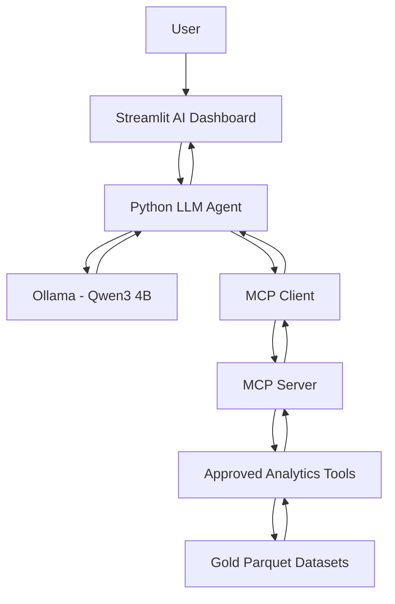

# PharmaFlow Agentic AI Analytics

## Overview

PharmaFlow includes a local, AI-powered analytics assistant that allows users to ask natural-language questions about synthetic pharmacy business data.

The assistant combines:

- Qwen3 4B for natural-language understanding
- Ollama for local AI inference
- Model Context Protocol (MCP) for tool integration
- Python analytics functions for verified calculations
- Streamlit for the interactive chat interface

The AI assistant operates separately from the publicly hosted analytics dashboard.

## Architecture



The diagram represents the logical components of the local AI workflow.

## Supported Analytics

The assistant supports read-only queries against three Gold datasets.

| Dataset | Analytics |
|---|---|
| `branch_revenue` | Branch rankings and total revenue |
| `medicine_revenue` | Medicine rankings and revenue |
| `supplier_spend` | Supplier rankings and total spending |

Example questions:

- What is the total supplier spending?
- Which are the top three pharmacy branches by revenue?
- Which medicines generate the highest revenue?

## Security Boundaries

The MCP server exposes only approved analytics operations.

Supported tools:

- `get_pharmacy_summary`
- `get_pharmacy_top_records`

The tool registry validates requests and rejects unsupported datasets and operations.

The AI assistant does not expose database deletion, administrative operations or unrestricted SQL execution.

The underlying analytics functions read synthetic Gold-layer Parquet datasets.

These safeguards restrict the available tool operations; they do not constitute a complete production security assessment.

## Local Setup

### Requirements

- Python 3.12
- Ollama installed locally
- Qwen3 4B model
- Python dependencies from `requirements.txt`

### Install Dependencies

```powershell
python -m pip install -r requirements.txt
```

### Download the AI Model

```powershell
ollama pull qwen3:4b
```

### Verify Ollama

```powershell
ollama list
```

### Start the AI Dashboard

From the project root:

```powershell
python -m streamlit run dashboard/ai_app.py
```

Open:

http://localhost:8501

### Test the MCP Integration

```powershell
python -m src.agents.test_mcp_client
```

### Run Agent Tests

```powershell
python -m pytest src/agents/ -v
```

## Validation

On 17 November 2026:

- 20 agent tests passed.
- 14 existing project tests passed separately.
- The MCP client successfully discovered and invoked approved tools.
- The local Streamlit AI dashboard returned verified branch revenue rankings and supplier spending.
- GitHub Pull Request #14 passed four CI checks and was merged into `main`.

The automated tests do not currently provide comprehensive end-to-end coverage of live LLM-to-MCP interactions.

## Deployment Limitations

The AI assistant currently runs locally.

Streamlit Community Cloud cannot directly connect to an Ollama server running on a developer's private Windows computer.

The publicly hosted PharmaFlow dashboard remains a separate analytics application.

Local CPU inference may be slow, and model responses may vary between runs.

## Future Improvements

- End-to-end AI integration testing
- More robust timeout and error handling
- Structured responses and improved numerical formatting
- AI service deployment with authentication
- Monitoring and evaluation of model responses
```
