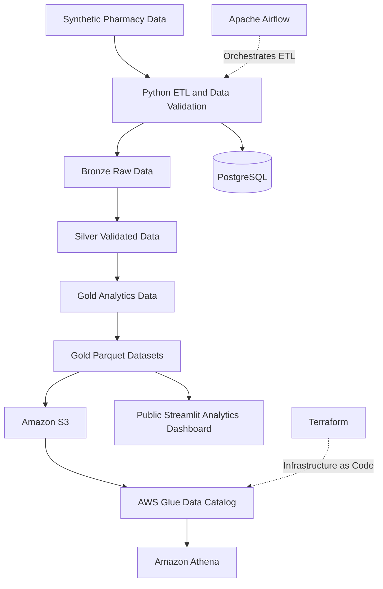
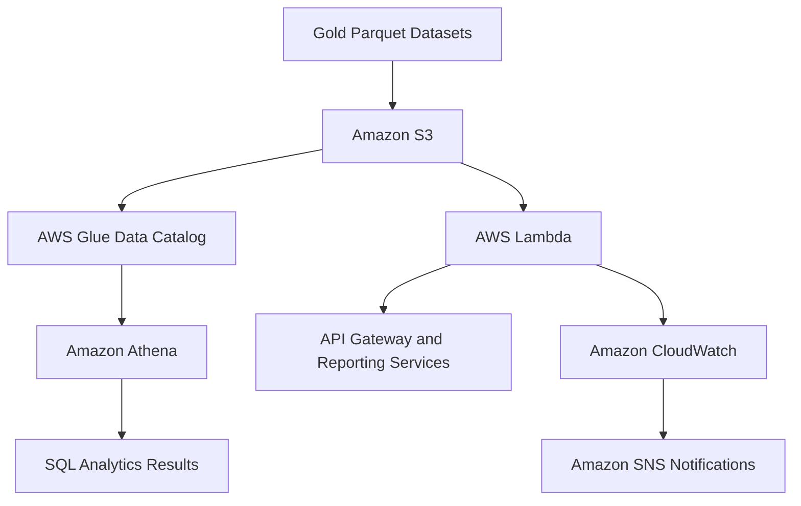
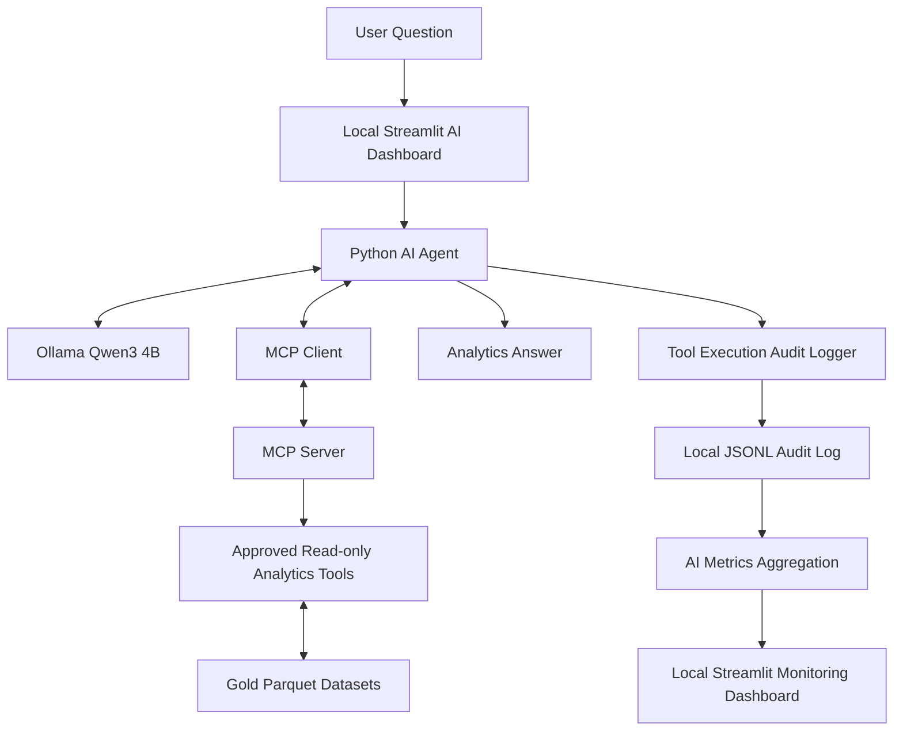

# PharmaFlow Architecture

## System Overview

PharmaFlow is an end-to-end data engineering and Agentic AI portfolio platform for synthetic pharmacy retail and wholesale analytics.

It combines Python ETL pipelines, a Bronze/Silver/Gold medallion architecture, PostgreSQL, Apache Airflow, AWS analytics services, Streamlit dashboards, and local AI-powered analytics.

The diagrams below represent the logical architecture. They do not imply that every component runs continuously in one production deployment.



## Data Layers

### Bronze Layer

Stores raw synthetic pharmacy datasets for traceability and subsequent processing.

### Silver Layer

Contains cleaned, standardized, and validated records.

Data quality checks include:

- Duplicate handling
- Required-field validation
- Invalid quantity rejection
- Negative-value checks
- Calculated-value verification

### Gold Layer

Contains curated analytics datasets for business reporting and AI-assisted analysis.

| Dataset | Purpose |
|---|---|
| `branch_revenue` | Branch revenue and transaction analysis |
| `medicine_revenue` | Medicine sales and revenue analysis |
| `supplier_spend` | Wholesale supplier purchasing analysis |

The Gold datasets are stored in Parquet format.

## Data Processing and Orchestration

Apache Airflow orchestrates the PharmaFlow medallion pipeline.

**DAG ID:** `pharmaflow_medallion_pipeline`

The pipeline coordinates source data generation, transformation, relational storage, and data quality validation.

Python, pandas, SQLAlchemy, PostgreSQL, and Apache Airflow support the local data engineering workflow.

## AWS Data Engineering Architecture

PharmaFlow integrates Amazon S3, AWS Glue, Amazon Athena, AWS Lambda, API Gateway, CloudWatch, and SNS.



### Amazon S3

Amazon S3 provides cloud storage for data lake outputs.

The project uses prefixes for:

- `bronze/`
- `silver/`
- `gold/`
- `audit/`

### AWS Glue Data Catalog

The analytics database is named `pharmaflow_analytics`.

Three external Parquet tables are registered:

- `branch_revenue`
- `medicine_revenue`
- `supplier_spend`

### Amazon Athena

The Athena workgroup is named `pharmaflow-analytics`.

Athena supports SQL queries against the curated Gold-layer datasets registered in AWS Glue.

### AWS Lambda and API Gateway

AWS Lambda supports ingestion and reporting integrations.

API Gateway provides an API integration layer for supported cloud services.

### Terraform

Terraform manages selected AWS infrastructure components, including Glue and Athena resources and monitoring infrastructure.

## AWS Monitoring

Amazon CloudWatch monitors configured Lambda error conditions.

CloudWatch alarms can notify Amazon SNS, which delivers alerts to a confirmed email subscriber.

This cloud monitoring capability is separate from the local Agentic AI execution monitoring system.

## Agentic AI Analytics Architecture

PharmaFlow includes a locally running AI analytics assistant that answers natural-language questions using approved MCP tools and curated Gold-layer datasets.



### AI Components

| Component | Responsibility |
|---|---|
| `dashboard/ai_app.py` | Streamlit AI chat interface |
| `src/agents/llm_agent.py` | AI model and MCP client orchestration |
| `src/agents/mcp_server.py` | Exposes approved MCP analytics tools |
| `src/agents/tool_registry.py` | Validates and dispatches approved tool requests |
| `src/agents/analytics_tools.py` | Reads and analyzes Gold Parquet datasets |
| `src/agents/audit_logger.py` | Records approved tool execution events |
| `src/agents/ai_metrics.py` | Loads audit events and calculates execution metrics |
| `dashboard/ai_monitoring.py` | Displays local AI monitoring metrics |
| Ollama | Runs the local Qwen3 4B model |

## MCP Security Boundaries

The MCP server exposes two approved analytics operations:

- `get_pharmacy_summary`
- `get_pharmacy_top_records`

These tools support read-only analytics against approved Gold-layer datasets.

The tool registry validates requests and rejects unsupported datasets and operations.

The assistant does not expose unrestricted SQL execution, database deletion, or infrastructure administration tools.

These controls restrict the assistant's available operations but do not represent a complete production security assessment.

## AI Audit Logging and Observability

PharmaFlow records approved tool execution events in a local JSONL audit log.

Each event includes:

- Timestamp
- Approved tool name
- Execution status
- Execution duration in milliseconds

Audit records do not store user questions or returned analytics results.

The AI metrics module calculates:

- Total tool executions
- Successful executions
- Failed executions
- Success rate
- Average execution duration
- Per-tool execution statistics

The monitoring dashboard displays aggregated metrics and recent audit events.

### Run the Local Monitoring Dashboard

```powershell
python -m streamlit run dashboard/ai_monitoring.py --server.port 8503
```

Open `http://localhost:8503`.

## Deployment and Operational Boundaries

PharmaFlow demonstrates connected engineering capabilities without requiring every component to run continuously.

### Public Analytics Application

The public Streamlit dashboard uses curated synthetic Gold-layer Parquet datasets.

Visitors do not need AWS credentials or a PostgreSQL connection.

**Live dashboard:** https://pharmaflow-analytics-dashboard.streamlit.app/

### Local Agentic AI Application

The AI assistant requires a locally accessible Ollama service, the Qwen3 4B model, and access to the Gold-layer datasets.

Run it using:

```powershell
python -m streamlit run dashboard/ai_app.py
```

### Local AI Monitoring Application

The AI monitoring dashboard reads local JSONL audit records and presents tool execution and reliability metrics.

### AWS Data Engineering Services

Amazon S3, AWS Glue, Athena, Lambda, API Gateway, CloudWatch, and SNS demonstrate cloud data storage, analytics, integration, and monitoring capabilities.

These AWS services are separate from the locally running Ollama and MCP assistant.

## Testing and Reliability

PharmaFlow includes automated tests covering data engineering, Agentic AI tool restrictions, reliability, audit logging, and monitoring metrics.

The latest locally verified results are:

| Test Suite | Passed |
|---|---:|
| Agentic AI tests | 63 |
| Existing project tests | 14 |
| **Total distinct tests** | **77** |

Run the tests using:

```powershell
python -m pytest src/agents/ -q
python -m pytest -q
```

## Additional Documentation

- [Agentic AI Documentation](agentic-ai.md)
- [Testing Documentation](testing.md)
- [AWS Glue and Athena Integration](aws-glue-athena.md)

The architecture describes a portfolio implementation rather than a continuously running production deployment.
