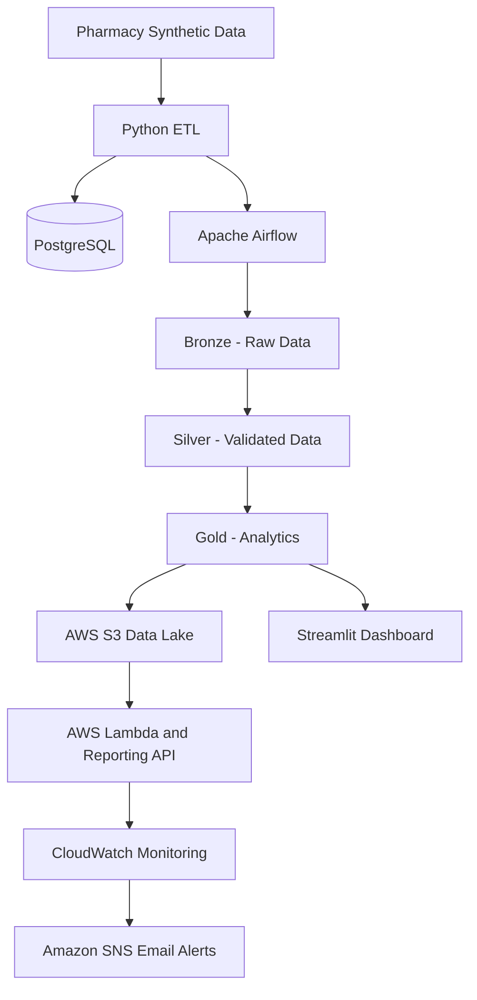
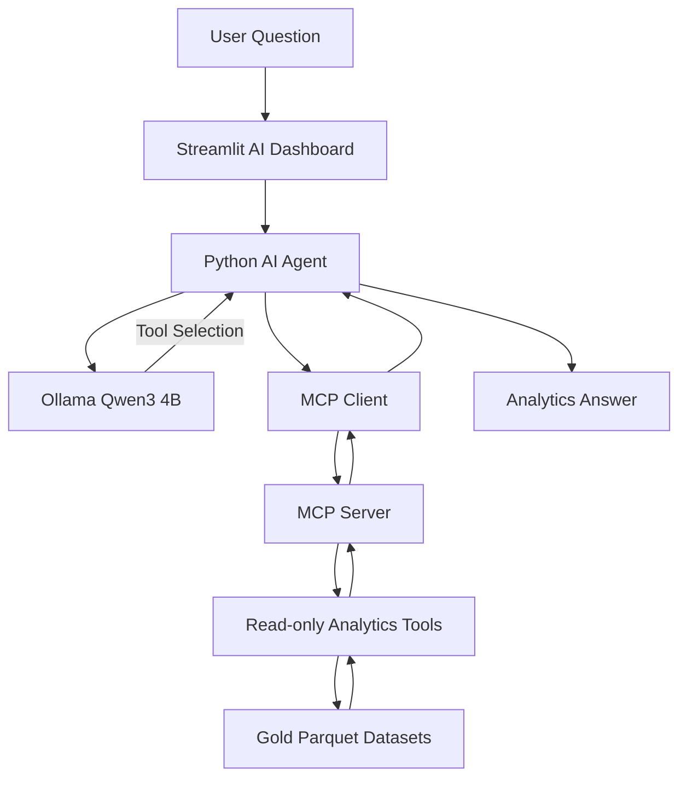

# PharmaFlow Architecture

## System Overview



## Data Layers

### Bronze
Stores raw source snapshots for traceability.

### Silver
Contains cleaned, standardized and validated records.

### Gold
Contains aggregated analytics datasets, including branch
revenue, medicine revenue and supplier spending.

## Orchestration

Apache Airflow runs the `pharmaflow_medallion_pipeline` DAG.

The pipeline generates source data, processes the medallion
layers, loads relational data and performs quality checks.

## Cloud Infrastructure

AWS S3 stores data lake outputs.

AWS Lambda supports ingestion and reporting services.

Terraform manages CloudWatch alarms, SNS topics and
monitoring permissions.

## Monitoring

CloudWatch tracks Lambda errors and sends alarm
notifications to Amazon SNS.

SNS delivers notifications to a confirmed email subscriber.
```

## Agentic AI Analytics Architecture

PharmaFlow includes a local AI assistant that queries curated Gold-layer datasets using approved MCP tools.



### AI Components

| Component | Responsibility |
|---|---|
| `dashboard/ai_app.py` | Streamlit chat interface |
| `src/agents/llm_agent.py` | AI model and MCP client orchestration |
| `src/agents/mcp_server.py` | Exposes approved MCP tools |
| `src/agents/tool_registry.py` | Validates and dispatches tool requests |
| `src/agents/analytics_tools.py` | Reads and analyzes Gold Parquet datasets |
| Ollama | Runs the local Qwen3 model |

### Deployment Boundary

The existing public Streamlit dashboard and local AI dashboard are separate applications.

The AI assistant requires a locally accessible Ollama service and access to the Gold-layer datasets.

The MCP tools are read-only and do not provide unrestricted database or infrastructure access.

See [Agentic AI Documentation](agentic-ai.md).
