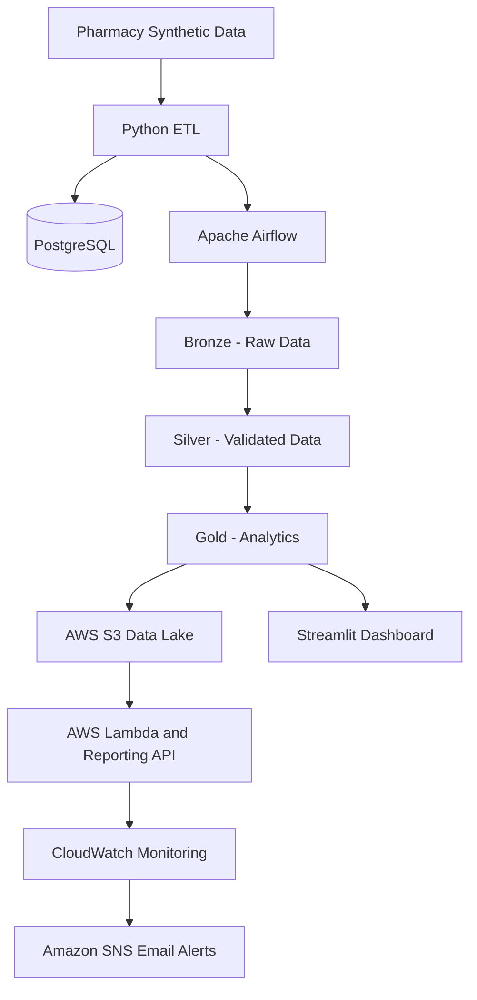

# PharmaFlow Architecture

## System Overview



## Data Layers

### Bronze
Stores raw source snapshots for traceability.

### Silver
Contains cleaned, standardized and validated records.

### Gold
Contains aggregated analytics datasets, including branch
revenue, medicine revenue and supplier spending.

## Orchestration

Apache Airflow runs the `pharmaflow_medallion_pipeline` DAG.

The pipeline generates source data, processes the medallion
layers, loads relational data and performs quality checks.

## Cloud Infrastructure

AWS S3 stores data lake outputs.

AWS Lambda supports ingestion and reporting services.

Terraform manages CloudWatch alarms, SNS topics and
monitoring permissions.

## Monitoring

CloudWatch tracks Lambda errors and sends alarm
notifications to Amazon SNS.

SNS delivers notifications to a confirmed email subscriber.
```
